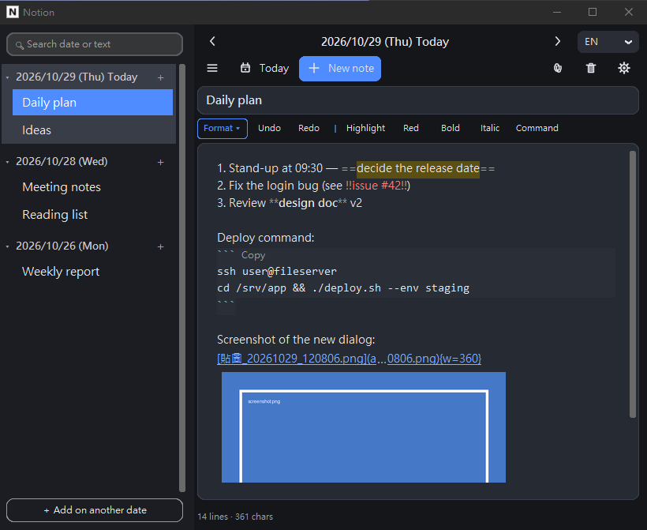
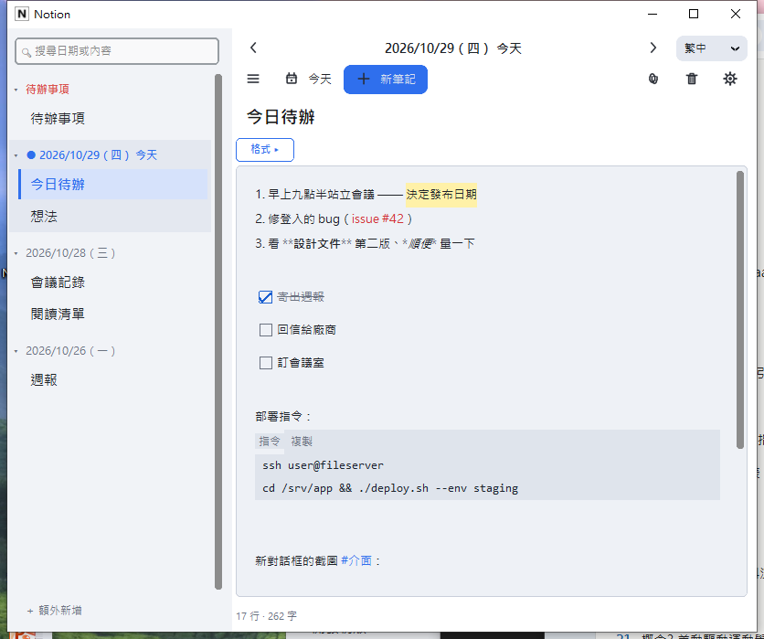
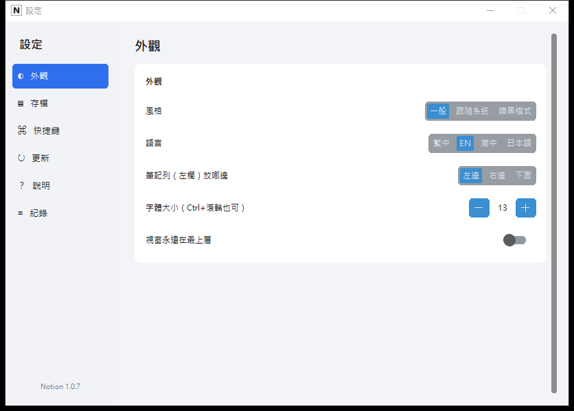
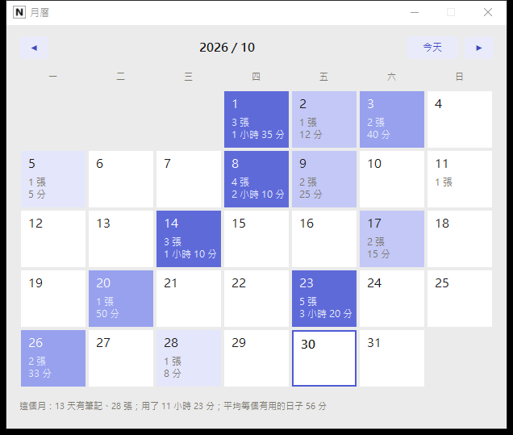

<!-- version: 1.0.9 -->
[繁體中文](README.md) | [English](README.en.md) | [日本語](README.ja.md) | **ไทย** | [हिन्दी](README.hi.md)

# Notion

แอปโน้ตแปะ (sticky notes) แบบเก็บในเครื่องสำหรับ Windows หนึ่งวันหนึ่งโฟลเดอร์ หนึ่งโน้ตหนึ่งไฟล์ ทุกอย่างอยู่บนคอมพิวเตอร์ของคุณเอง ไม่ผ่านคลาวด์ ไม่ต้องมีบัญชี และไม่เก็บข้อมูลใด ๆ
เขียนด้วย Python 3.12 (หน้าจอ: tkinter + customtkinter; แพ็กเกจด้วย PyInstaller)

> โฟลเดอร์นี้แชร์เฉพาะโค้ดและโครงสร้างของเครื่องมือ ไม่มีโน้ตของผู้ใช้หรือข้อมูลอื่นใด



| หน้าจอภาษาจีนตัวเต็ม (สว่าง) | การตั้งค่า (แท็บ) |
|---|---|
|  |  |



แผงด้านข้างเรียงโน้ตตามวัน ☆ หน้าชื่อคือรายการโปรด ตรงกลางคือชื่อและเนื้อหา `==เน้น==`, `!!แดง!!`, `**ตัวหนา**` จะมีสีทันทีที่พิมพ์ บล็อก ``` มีปุ่ม "คัดลอก" และภาพหน้าจอแสดงในโน้ตได้เลย ภาษา ปุ่มลัด ตำแหน่งแผงด้านข้าง และการอัปเดตอยู่ที่ ⚙ การตั้งค่า มุมขวาบน

## ฟีเจอร์

| ฟีเจอร์ | รายละเอียด |
|---|---|
| โน้ตตามวัน | แผงด้านข้างจัดกลุ่มวันละกลุ่ม วันหนึ่งมีกี่โน้ตก็ได้ คลิกวันที่เพื่อพับ กดค้างที่โน้ตแล้วลากเพื่อจัดลำดับภายในวัน "เพิ่มในวันอื่น" ให้เลือกวันก่อน (สำหรับบันทึกย้อนหลัง) "+ โน้ตใหม่" / Ctrl+N เพิ่มในวันนี้เสมอ |
| รายการโปรด | คลิก ☆ หน้าชื่อให้เป็น ★ จะมีกลุ่ม "★ รายการโปรด" ด้านบนสุด (ใต้ To-do) คลิกแล้วเปิดโน้ตนั้น คลิกอีกครั้งเพื่อเอาออก |
| To-do | โน้ตสีแดงหนึ่งใบตรึงอยู่บนสุด ไม่ขึ้นกับวันใด (เก็บในโฟลเดอร์ `9999-12-31` จึงเรียงบนสุดเสมอ) |
| รายการเช็ก | บรรทัดที่ขึ้นต้นด้วย `- [ ] ` (ปุ่ม "เช็ก" ในแถบรูปแบบ หรือพิมพ์เอง) กลายเป็นช่องสี่เหลี่ยม คลิกเพื่อติ๊ก รายการที่เสร็จจะมีเส้นขีดฆ่า ในไฟล์เก็บเป็น `- [x]` แบบ GitHub |
| #แท็ก | `#projectA` ในเนื้อหาแสดงด้วยสีเน้น Ctrl+คลิกเพื่อค้นหาแท็กนั้นในแผงด้านข้าง |
| เมนูคลิกขวา | เนื้อหาและชื่อ: ตัด คัดลอก วาง (ภาพหน้าจอในคลิปบอร์ดจะกลายเป็นรูป) เลือกทั้งหมด คัดลอกเป็นข้อความล้วน; แถวโน้ต: เปิด คัดลอกไปวันนี้ ส่งออก เวอร์ชันเก่า รายการโปรด แชร์ ลบ; หัววัน: เพิ่มในวันนี้ ส่งออกทั้งวันเป็น `.md` ไฟล์เดียว ล้างทั้งวัน |
| บันทึกอัตโนมัติ | บันทึกหลังหยุดพิมพ์ 1.2 วินาที และเมื่อสลับหรือปิด ถ้าบันทึกไม่ได้จะเก็บไฟล์กู้คืนไว้; ถ้าโปรแกรมอื่นแก้โน้ตที่เปิดอยู่ จะโหลดใหม่ให้เองเมื่อไม่ได้พิมพ์ และเตือนถ้ากำลังพิมพ์ |
| เครื่องหมาย | เลือกข้อความแล้วใส่ `==เน้น==` (พื้นเหลือง), `!!เตือน!!` (ตัวแดง), `**ตัวหนา**`, `*ตัวเอียง*` ไฟล์เก็บเครื่องหมายเหล่านี้ไว้ ส่งออกแล้วยังอ่านได้ เครื่องหมายจะซ่อนไว้ยกเว้นบรรทัดที่เคอร์เซอร์อยู่ |
| บล็อกคำสั่ง | บล็อก ``` ใช้ฟอนต์ความกว้างคงที่บนพื้นเข้ม มีหัว "คำสั่ง | คัดลอก" คัดลอกทั้งบล็อกในคลิกเดียว (คำสั่งที่ใช้บ่อย พรอมต์) |
| ลิงก์ | URL และพาธ Windows (รวม `\\server\...`) กลายเป็นลิงก์อัตโนมัติ Ctrl+คลิกเพื่อเปิด ไฟล์ที่รันได้จะถามก่อน |
| รูปภาพและไฟล์ | Ctrl+V วางภาพหน้าจอแสดงทันที ลากที่มุมเพื่อย่อขยาย ลาก `.md` / `.txt` (ไม่เกิน 1 MB) เข้าหน้าต่างเพื่อเป็นโน้ตของวันนี้ ไฟล์ชนิดอื่นไม่รับ (ใช้ 📎 สำหรับไฟล์แนบ) |
| รายการ | `1. ` / `- ` ต้นบรรทัด กด Enter แล้วต่อรายการถัดไปให้เอง |
| ค้นหา | Ctrl+F ตามวันที่หรือเนื้อหา แสดง "กำลังค้นหา" เมื่อโน้ตเยอะ |
| ปุ่มลัด | การตั้งค่า → ปุ่มลัด: เปลี่ยนคีย์ของแต่ละฟังก์ชันได้เอง ต้องมี Ctrl หรือ Alt คีย์คัดลอก/วางของระบบใช้ไม่ได้ สองฟังก์ชันใช้คีย์เดียวกันไม่ได้ และรีเซ็ตเป็นค่าเริ่มต้นได้ |
| การเข้ารหัส | เปิดโดยค่าเริ่มต้น ผูกกับบัญชี Windows (DPAPI) ถอดไดรฟ์ไปเครื่องอื่นจะอ่านไม่ได้ ก่อนเปลี่ยนเครื่องให้ "ส่งออกทั้งหมด" รายละเอียด: [docs/加密與本機說明.md](docs/加密與本機說明.md) (ใน zip มีฉบับ .txt) |
| นำเข้า / ส่งออก | ส่งออกหนึ่งโน้ต ทั้งวัน (รวมเป็นไฟล์เดียว) หรือทั้งหมดเป็น `.md` ข้อความล้วน นำเข้า `.md` / `.txt` (ตรวจจับ UTF-8, UTF-16, Big5, GBK, Shift-JIS ได้) |
| เวอร์ชันและถังขยะ | ทุกโน้ตเก็บสแนปช็อตเวอร์ชันเก่า (คลิกขวา "เวอร์ชันเก่า…" เพื่อดูหรือกู้คืน ก่อนกู้คืนจะเก็บเนื้อหาปัจจุบันไว้ด้วย) โน้ตที่ลบจะเข้าถังขยะก่อน "กู้คืนการลบครั้งล่าสุด" นำกลับมาได้ |
| แชร์ | คลิกขวาที่โน้ต → แชร์: ส่งทางอีเมล (เปิดแอปอีเมล หัวข้อ = ชื่อ เนื้อหา = ข้อความล้วน) หรือคัดลอกไปโฟลเดอร์ซิงก์ของ Google Drive เดสก์ท็อป (หาไม่เจอจะให้เลือกโฟลเดอร์) |
| หลายภาษา | อังกฤษ (ค่าเริ่มต้น) จีนตัวเต็ม จีนตัวย่อ ญี่ปุ่น สลับที่ การตั้งค่า → ลักษณะ โดยไม่ต้องเปิดใหม่ ตารางแปลเป็น csv ไฟล์เดียว เพิ่มคอลัมน์ก็เพิ่มภาษาได้ |
| อัปเดต | หลังเปิดไม่กี่วินาที แอปจะตรวจ GitHub Releases ว่ามีเวอร์ชันใหม่ไหม (อ่านแค่เลขเวอร์ชัน) ถ้ามีจะเตือน: ดาวน์โหลด zip ข้ามเวอร์ชันนี้ หรือปิดการเตือน (การตั้งค่า → อัปเดต) การอัปเดต = ปิดแอปแล้วแทนที่ `Notion.exe` โน้ตและการตั้งค่าไม่ถูกแตะต้อง |
| ปฏิทินและเวลาใช้งาน | ปุ่ม “ปฏิทิน” บนแถบเครื่องมือหรือ Ctrl+M: เดือนนี้วันไหนมีโน้ตและใช้แอปนานแค่ไหนในแต่ละวัน (แผนที่ความร้อน) คลิกวันที่เพื่อข้ามไป เวลานับเฉพาะตอนหน้าต่างมีโฟกัสและมีการใช้งาน เก็บใน `.app/usage.json`; การตั้งค่า → อัปเดต → ประวัติเวอร์ชัน แสดงสิ่งที่เปลี่ยนในทุกเวอร์ชัน |
| ลิงก์โน้ตและเทมเพลต | พิมพ์ `[[ชื่อ]]` (หรือคลิกขวาที่โน้ต → “คัดลอกลิงก์โน้ต”) แล้ว Ctrl+คลิกเพื่อข้ามไป; “ย้อนกลับ” (Alt+Left) กลับโน้ตก่อนหน้า; พิมพ์ `[[` จะแสดงรายชื่อโน้ตให้เลือก; `[[2026-10-29]]` ลิงก์ไปวันนั้น; กดค้างโน้ตในแถบข้างแล้วลากเข้าเนื้อหาเพื่อแทรกลิงก์; ใต้เนื้อหามีแถว “ลิงก์มาจาก” (backlinks); เปลี่ยนชื่อโน้ตแล้ว `[[ลิงก์]]` ในโน้ตอื่นอัปเดตให้เอง; “โน้ตใหม่ ▾” เริ่มจากเทมเพลต (เพิ่มเองได้ใน .app/templates); ปุ่ม “ค้างอยู่” (Ctrl+L) แสดงทุกรายการที่ยังไม่ติ๊ก คัดลอกเป็นข้อความได้; การตั้งค่า → ไฟล์ ส่งออกช่วงวันที่; Tab เยื้องบรรทัดรายการ; #แท็กล่าสุดใต้ช่องค้นหา |
| แนะนำการใช้งาน | เปิดครั้งแรกมีคำแนะนำ 5 หน้า แสดงครั้งเดียว ดูอีกได้ที่ การตั้งค่า → อัปเดต |
| ลักษณะ | สว่าง / ตามระบบ / มืด; Ctrl+ล้อเมาส์ซูม; แผงด้านข้างวางซ้าย ขวา หรือล่าง ลากปรับความกว้างได้; แถบรูปแบบพับได้; โน้ตว่างมีคำใบ้; "บันทึกแล้ว" จางหายเอง; หน้าต่างย่อยเปิดกลางหน้าต่างหลัก |
| อื่น ๆ | เปิดได้ครั้งละหนึ่งอินสแตนซ์; หน้าจอเริ่มต้น; งานที่ใช้เวลานานแสดงความคืบหน้า; นับบรรทัดและตัวอักษร; หลังเที่ยงคืนเครื่องหมาย "วันนี้" ย้ายเอง |

## วิธีใช้

**แค่ใช้งาน**: นำ zip ที่แพ็กแล้ว (`Notion.exe` + `Notion.bat` + คู่มือ .txt 2 ไฟล์ สร้างโดย `tools/make_release.py`) ไปแตกไว้ที่ไหนก็ได้

**clone มาแก้เอง** (โฟลเดอร์นี้ไม่มี exe):
```
pip install -r requirements.txt
python -m personalnote          # รัน
build_exe.bat                   # หรือสร้าง dist\Notion.exe (รันเทสต์ก่อน)
```
ดับเบิลคลิก `Notion.bat` ในโฟลเดอร์นี้ก็ได้ ถ้าไม่พบ exe มันจะตรวจ Python และแพ็กเกจ แล้วบอกว่าขาดอะไร

1. ต้องใช้ Windows 10 / 11 (64 บิต) เวอร์ชันแพ็กแล้วไม่ต้องติดตั้งอะไรเพิ่ม
2. รัน `Notion.bat` (ใน .bat ตั้งโฟลเดอร์เก็บโน้ต ภาษา ฟอนต์ จะตรวจอัปเดตหรือไม่ ฯลฯ ได้ เว้นว่าง = ใช้ค่าในแอป) ครั้งแรก Windows อาจแสดง "Windows protected your PC" → "More info" → "Run anyway" (exe ไม่มีลายเซ็นดิจิทัล)
3. โน้ตเก็บในโฟลเดอร์ `Notion` บนเดสก์ท็อปโดยค่าเริ่มต้น เปลี่ยนได้ที่ ⚙ การตั้งค่า → ไฟล์
4. เปิดพร้อม Windows: กด Win+R พิมพ์ `shell:startup` แล้ววางทางลัดของ `Notion.bat` ไว้ในนั้น (การตั้งค่า → ไฟล์ มีปุ่ม "เปิดโฟลเดอร์ startup")

ปุ่มลัด (ค่าเริ่มต้น เปลี่ยนได้ในการตั้งค่า): Ctrl+N โน้ตใหม่ (วันนี้), Ctrl+T วันนี้, Ctrl+F ค้นหา, Ctrl+S บันทึกทันที, Ctrl+\ ซ่อน/แสดงแผงด้านข้าง, Ctrl+PgUp / PgDn วันก่อน / วันถัดไป, Ctrl+H / Ctrl+Shift+H เน้น / แดง, Ctrl+B / I หนา / เอียง, Ctrl+Shift+C บล็อกคำสั่ง, Ctrl+= / Ctrl+- ขนาดตัวอักษร

## ข้อมูลเก็บที่ไหน

```
Notion/                       ← โฟลเดอร์โน้ต (สำรองทั้งโฟลเดอร์ได้เลย)
  2026-10-28/001.note         ← หนึ่งโน้ตหนึ่งไฟล์; .note เข้ารหัส, .md ข้อความล้วน; บรรทัดแรก "# ชื่อ"
  attachments/                ← รูปที่วางและไฟล์แนบ (ไม่เข้ารหัส)
  .app/settings.json          ← การตั้งค่าในแอป (รวมปุ่มลัด การเตือนอัปเดต); state.json สถานะหน้าต่างและตำแหน่งแผง;
                                 order.json ลำดับที่จัดเอง; favorites.json รายการโปรด; history/ สแนปช็อต; trash/ ถังขยะ; error.log
%LOCALAPPDATA%\PersonalNote\logs   ← personalnote.log, crash.log; rescue/ ไฟล์กู้คืน
```

การเข้ารหัสครอบคลุม: เนื้อหาโน้ตและสแนปช็อต ไฟล์แนบ ไฟล์ .md ที่ส่งออก และชื่อไฟล์ในถังขยะไม่เข้ารหัส การเข้ารหัสผูกกับบัญชี Windows: เครื่องใหม่ ติดตั้งระบบใหม่ หรือลบบัญชีแล้วจะเปิดไม่ได้ ให้ส่งออกทั้งหมดก่อน

แอปไม่เชื่อมต่อเครือข่ายใด ๆ ยกเว้นอ่านเลขเวอร์ชันจาก GitHub หนึ่งครั้งตอนเปิด ใส่ `set NOTE_UPDATE_CHECK=0` ใน `Notion.bat` เพื่อปิดแม้แต่ส่วนนั้น

## โครงสร้าง (สำหรับผู้ดูแล)

โครงสร้างโมดูลและกฎการพัฒนาอยู่ใน [README.en.md](README.en.md) หัวข้อ "Architecture" (เนื้อหาเหมือนกัน)

## พัฒนาและแพ็กเกจ

```
pip install -r requirements.txt
python -m personalnote                 # รัน
python -m unittest discover -s tests   # ยูนิตเทสต์
python tools/stress/ui_checks.py       # ขับหน้าต่างจริง (วางนอกจอ)
build_exe.bat                          # สร้าง dist\Notion.exe (รันเทสต์และตรวจตารางแปลก่อน)
python tools/make_release.py --dest <โฟลเดอร์> [--publish]   # โฟลเดอร์แจกจ่าย + zip; --publish อัปโหลดขึ้น GitHub Releases (ต้องมี gh)
python tools/check_public_words.py     # สแกนคำที่ห้ามปรากฏก่อน commit
```

## ระบบที่รองรับและสัญญาอนุญาต

- Windows 10 / 11 เป็นแพลตฟอร์มหลัก; Windows 7 / 8.0 ใช้ไม่ได้ (Python 3.12 ต้องการ 8.1 ขึ้นไป) `Notion.bat` จะอธิบายและหยุด
- Linux: ส่วนที่ขึ้นกับ OS อยู่ใน `platform_.py`; `Notion.sh` / `build_linux.sh` รันและแพ็กได้; ไม่มีการเข้ารหัสและลากวาง; ยังไม่ได้ทดสอบบนเครื่องจริง
- ไม่แนบไฟล์ฟอนต์ ใช้ฟอนต์ของระบบ ส่วนประกอบภายนอก: Python (PSF), Tcl/Tk (แบบ BSD), customtkinter (MIT), Pillow (MIT-CMU), PyInstaller (GPL พร้อมข้อยกเว้น)

## ข้อจำกัดที่ทราบ

- การเข้ารหัสผูกกับบัญชี Windows (ดูด้านบน) "เปลี่ยนโฟลเดอร์" ไม่ย้ายโน้ตเก่า
- รูปย่อขยายตามสัดส่วนจากมุมเท่านั้น; GIF ไม่เคลื่อนไหว
- ถ้า Windows ปิดเครื่องกะทันหัน ข้อความ 1.2 วินาทีสุดท้ายอาจหาย
- เปิดสองอินสแตนซ์บนโฟลเดอร์เดียวกัน (เช่น RDP กับเครื่องจริง) ไม่มีการป้องกัน การบันทึกครั้งหลังจะทับ
- แผงด้านข้างแสดงได้ครั้งละไม่เกิน 1000 โน้ต ที่เหลือใช้ค้นหา
- exe ไม่มีลายเซ็น SmartScreen จะบล็อกครั้งแรกหนึ่งครั้ง
